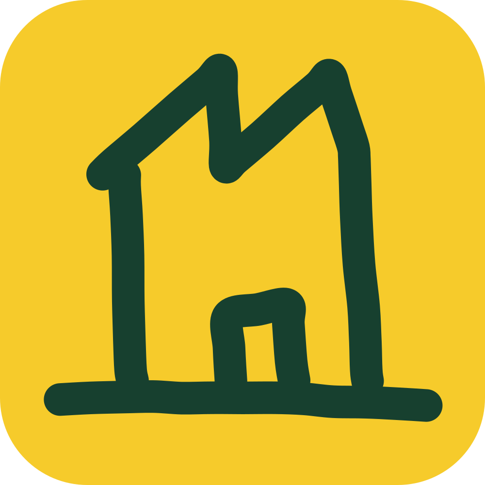

# Firmafakta MCP

Hosted MCP servers over the Swedish company registers (SCB, Bolagsverket, PRV). Your AI
assistant counts and lists companies by industry, place and size, and looks up single companies
by organisation number.

This repository holds the metadata and plugins for two hosted MCP connections, and the plugin
marketplace that installs them. The servers themselves are not open source; the license covers
the contents of this repository.

| Connection | Address | Login | For |
|---|---|---|---|
| **Firmafakta** | `https://mcp.firmafakta.se` | your Firmafakta account (OAuth or API key) | the full service; a free account gives 100 credits a month and saved segments, a paid plan more |
| **Firmafakta Free** | `https://mcp.firmafakta.se/free` | none | a limited first look without an account: 10 credits a month and a small daily quota of free company lookups |

## Install as a plugin

The marketplace `firmafakta/mcp` has one plugin per connection:

- **Firmafakta** (`firmafakta`): the full service on your Firmafakta account,
  `https://mcp.firmafakta.se`. You log in the first time you use it; an account is free to create
  and gives 100 credits a month, and a paid plan gives more.
- **Firmafakta Free** (`firmafakta-free`): basic exploration without an account,
  `https://mcp.firmafakta.se/free`. Limited to 10 credits a month and a small daily quota of free
  company lookups. For more credits and saved segments, use the Firmafakta plugin with a free
  account.

**Claude Code:**

```sh
/plugin marketplace add firmafakta/mcp
/plugin install firmafakta@firmafakta
```

Without an account: `/plugin install firmafakta-free@firmafakta`.

**Claude** (claude.ai, Desktop): add the marketplace `firmafakta/mcp` under Customize, then
install Firmafakta, or Firmafakta Free without an account.

**ChatGPT and Codex:** add the plugin marketplace `firmafakta/mcp`, then install Firmafakta, or
Firmafakta Free without an account.

**Cursor** (Teams and Enterprise): an admin imports the marketplace `firmafakta/mcp` from GitHub
under Dashboard → Plugins & MCPs; then install Firmafakta, or Firmafakta Free without an account,
under Customize.

## Connect without a plugin

Add Firmafakta as a remote (Streamable HTTP) MCP server with the address
`https://mcp.firmafakta.se` and sign in with your Firmafakta account when your client asks.
Step by step per assistant: [firmafakta.se/en/ai](https://firmafakta.se/en/ai/).

## API key

For agents that cannot sign in with OAuth: create a key under My account on
[firmafakta.se](https://firmafakta.se/) and send it on every request as
`Authorization: Bearer <key>`.

## Tools

| Tool | What it does |
|---|---|
| `firmafakta_describe` | The segment language, the fields and the plan each needs, your plan, credits and prices |
| `firmafakta_find_codes` | Finds SNI industry codes, municipalities, counties and other codes by text |
| `firmafakta_count` | Counts a segment and reads it back in words |
| `firmafakta_fetch` | Fetches a segment's companies or workplaces, a page at a time |
| `firmafakta_lookup` | Everything on one company, by organisation number |
| `firmafakta_annual_report` | A company's annual report from Bolagsverket as one PDF, for credits (Firmafakta only) |
| `firmafakta_company` | A company as the public company page shows it, by organisation number or name, free |
| `firmafakta_save` | Saves a segment to your account (Firmafakta only) |
| `firmafakta_load` | Lists or loads saved segments (Firmafakta only) |
| `firmafakta_update` | Renames a saved segment or replaces its expression (Firmafakta only) |
| `firmafakta_delete` | Deletes a saved segment (Firmafakta only) |

Counting and fetching cost credits, the same credits as on the web; `firmafakta_describe` tells
the assistant the prices, so it can ask you before it spends. Sole proprietorships are counted but
never listed.

## Try

- How many construction companies with 10 to 49 employees are there in Halland?
- Find all accounting firms in Gothenburg municipality and give me the list.
- Find accounting firms in Gothenburg municipality started in the last five years.

## Support

support@firmafakta.se · [Pricing](https://firmafakta.se/en/priser/) ·
[Privacy](https://firmafakta.se/en/integritet/) · [Terms](https://firmafakta.se/en/villkor/)
